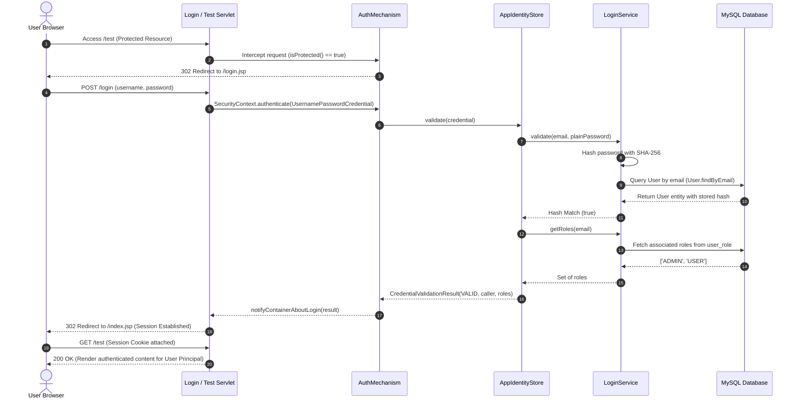
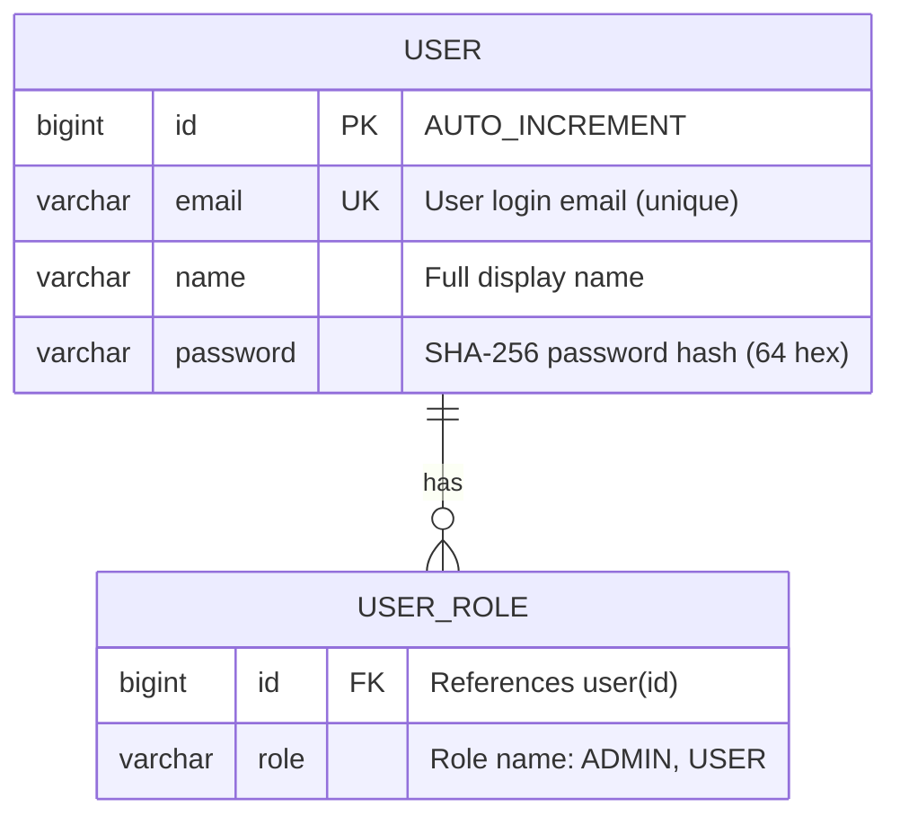

<div align="center">

# J2EE Security ORM

**Enterprise Jakarta EE 10 Authentication, Authorization & ORM Architecture**

An enterprise-grade reference architecture demonstrating modern Jakarta Security (JSR 375), custom HTTP authentication mechanisms, credential validation with SHA-256 hashing, and container-managed JPA / Hibernate persistence on MySQL.

[](https://www.oracle.com/java/)
[](https://jakarta.ee/)
[](https://hibernate.org/orm/)
[](https://www.mysql.com/)
[](https://maven.apache.org/)
[](LICENSE)

</div>

---

## Overview

**J2EE-Security-ORM** provides a robust, decoupled security and data persistence foundation for modern Java enterprise applications. It replaces legacy XML-heavy deployment descriptor security with declarative, type-safe Jakarta Security specifications, combining CDI dependency injection, container-managed transactions (JTA), and Hibernate ORM for complete access control and identity lifecycle management.

### Key Architectural Highlights
- **Jakarta Security (JSR 375):** Custom `HttpAuthenticationMechanism` implementation using `@AutoApplySession` for non-intrusive request interception and stateful session binding.
- **Custom Identity Store:** Decoupled `IdentityStoreHandler` pattern resolving credentials and role assignments dynamically via JPA entity services.
- **Cryptographic Security:** SHA-256 one-way cryptographic hashing for secure password storage and verification.
- **Declarative RBAC:** Servlet-level authorization enforced through `@ServletSecurity`, `@DeclareRoles`, and `@HttpConstraint`.
- **Relational ORM Mapping:** Jakarta Persistence 3.0 entity modeling with Hibernate ORM, utilizing `@ElementCollection` for dynamic multi-role assignments.
- **JTA Transaction Management:** Container-managed transactions via JNDI data sources and `SunOneJtaPlatform` integration.

---

## System Architecture

```mermaid
flowchart TD
    Client["Web Browser / HTTP Client"]

    subgraph Presentation["Presentation & Web Layer"]
        JSP["JSP Views<br/>(login.jsp, signup.jsp, index.jsp)"]
        LoginServlet["Login Servlet<br/>(/login)"]
        SignupServlet["Signup Servlet<br/>(/signup)"]
        TestServlet["Protected Test Servlet<br/>(/test - @ServletSecurity)"]
    end

    subgraph Security["Jakarta Enterprise Security (JSR 375)"]
        AuthMech["AuthMechanism<br/>(HttpAuthenticationMechanism)"]
        SecContext["SecurityContext"]
        IdStoreHandler["IdentityStoreHandler"]
        AppIdStore["AppIdentityStore<br/>(IdentityStore)"]
        PasswordHash["PasswordUtil<br/>(SHA-256 Hashing)"]
    end

    subgraph Service["Business & Service Layer"]
        LoginSvc["LoginService<br/>(@RequestScoped)"]
        SignupSvc["SignupService<br/>(@RequestScoped, @Transactional)"]
    end

    subgraph Persistence["Persistence & Database Layer"]
        EM["EntityManager<br/>(PersistenceContext: JIAT-Security)"]
        UserEntity["User Entity<br/>(@Entity, @Table)"]
        UserRoleTable["user_role<br/>(@ElementCollection)"]
        MySQL[("MySQL 8.0+<br/>j2ee-security-orm")]
    end

    Client -->|HTTP GET / POST| JSP
    Client -->|POST Credentials| LoginServlet
    Client -->|POST New Account| SignupServlet
    Client -->|Access Protected Endpoint| TestServlet

    LoginServlet -->|authenticate()| SecContext
    SecContext --> AuthMech
    TestServlet -->|Container Security Interception| AuthMech

    AuthMech -->|validate()| IdStoreHandler
    IdStoreHandler --> AppIdStore
    AppIdStore -->|validate() & getRoles()| LoginSvc
    SignupServlet -->|hash()| PasswordHash
    SignupServlet -->|register()| SignupSvc

    LoginSvc -->|compare hash| PasswordHash
    LoginSvc -->|NamedQuery: User.findByEmail| EM
    SignupSvc -->|persist()| EM

    EM --> UserEntity
    UserEntity --> UserRoleTable
    EM -->|JTA DataSource: j2ee-security-pool| MySQL
```

---

## Authentication & Authorization Workflow



---

## Data Model & ER Architecture



---

## Repository Structure

```
J2EE-Security-ORM/
├── database/
│   └── schema.sql                 # Complete MySQL DDL schema and seed dataset
├── src/
│   ├── main/
│   │   ├── java/com/thikka/
│   │   │   ├── entity/
│   │   │   │   └── User.java      # JPA User entity with @ElementCollection roles
│   │   │   ├── model/
│   │   │   │   └── User.java      # Domain model DTO representation
│   │   │   ├── security/
│   │   │   │   ├── AuthMechanism.java    # HttpAuthenticationMechanism & session handler
│   │   │   │   └── AppIdentityStore.java # Database-backed IdentityStore implementation
│   │   │   ├── service/
│   │   │   │   ├── LoginService.java     # Credential check & role resolution
│   │   │   │   └── SignupService.java    # Registration transaction & duplicate checks
│   │   │   ├── servlet/
│   │   │   │   ├── Login.java     # /login authentication handler
│   │   │   │   ├── Signup.java    # /signup registration workflow
│   │   │   │   └── Test.java      # /test role-guarded protected servlet
│   │   │   └── util/
│   │   │       └── PasswordUtil.java     # SHA-256 cryptographic hashing helper
│   │   ├── resources/
│   │   │   └── META-INF/
│   │   │       └── persistence.xml       # JPA configuration (JTA, Hibernate provider)
│   │   └── webapp/
│   │       ├── WEB-INF/
│   │       │   └── web.xml               # Deployment descriptor
│   │       ├── index.jsp                 # Authenticated landing portal
│   │       ├── login.jsp                 # Credential submission interface
│   │       └── signup.jsp                # Self-service registration form
├── .gitignore                     # Production hardened gitignore
├── LICENSE                        # MIT Open Source License
└── pom.xml                        # Maven project descriptor & dependencies
```

---

## Getting Started

### Prerequisites
- **JDK:** OpenJDK 17 LTS
- **Build Tool:** Apache Maven 3.8+
- **Database:** MySQL Server 8.0+
- **Application Server:** GlassFish 7.x, Payara 6.x, or Jakarta EE 10 Web Profile compatible container

---

### Step 1: Database Setup
Connect to MySQL and execute the setup script located in `database/schema.sql`:

```bash
mysql -u root -p < database/schema.sql
```

The script initializes:
1. `j2ee-security-orm` database.
2. `user` and `user_role` tables with foreign keys and unique constraints.
3. Pre-seeded accounts with secure SHA-256 hashes.

---

### Step 2: Application Server JNDI Configuration
The persistence unit `JIAT-Security` in `persistence.xml` references the JNDI resource `j2ee-security-pool`. Configure this connection pool in your GlassFish / Payara administrative console or via `asadmin`:

```bash
# 1. Create the MySQL JDBC Connection Pool
asadmin create-jdbc-connection-pool \
  --datasourceclassname com.mysql.cj.jdbc.MysqlDataSource \
  --restype javax.sql.DataSource \
  --property serverName=localhost:portNumber=3306:databaseName=j2ee-security-orm:user=root:password=yourpassword:useSSL=false:allowPublicKeyRetrieval=true \
  j2ee-security-pool

# 2. Create the JDBC Resource mapping
asadmin create-jdbc-resource \
  --connectionpoolid j2ee-security-pool \
  j2ee-security-pool
```

---

### Step 3: Build the Application
Compile the source code and assemble the deployable Web Application Archive (`WAR`):

```bash
mvn clean package
```

Upon successful compilation, the artifact is generated at:
```
target/J2EE-Security-ORM.war
```

---

### Step 4: Deploy & Run
Deploy the WAR package directly to your application server:

```bash
asadmin deploy target/J2EE-Security-ORM.war
```

Access the application in your browser:
- **Home Portal:** `http://localhost:8080/J2EE-Security-ORM/index.jsp`
- **Login Page:** `http://localhost:8080/J2EE-Security-ORM/login.jsp`
- **Sign Up Page:** `http://localhost:8080/J2EE-Security-ORM/signup.jsp`
- **Protected Endpoint:** `http://localhost:8080/J2EE-Security-ORM/test`

---

## Seed Accounts & Security Testing

| Account Email | Plain Password | Roles Assigned | Access Permissions |
| :--- | :--- | :--- | :--- |
| `admin@example.com` | `admin123` | `ADMIN`, `USER` | Full access to `/test` and administrative scopes |
| `user@example.com` | `user123` | `USER` | Standard access to `/test` |

---

## License

This project is licensed under the **MIT License** — see the [LICENSE](LICENSE) file for details.

---

## Author

**Theekshana Sudeepa**  
- **LinkedIn:** [linkedin.com/in/theekshana-sudeepa](https://www.linkedin.com/in/theekshana-sudeepa/)  
- **GitHub:** [github.com/theekshana-sudeepa](https://github.com/theekshana-sudeepa)  
- **Website:** [lexoratech.com](https://lexoratech.com)
